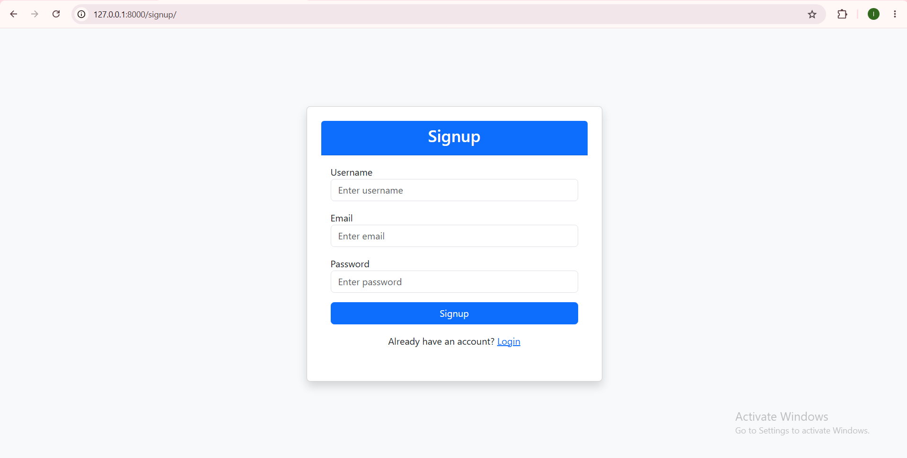
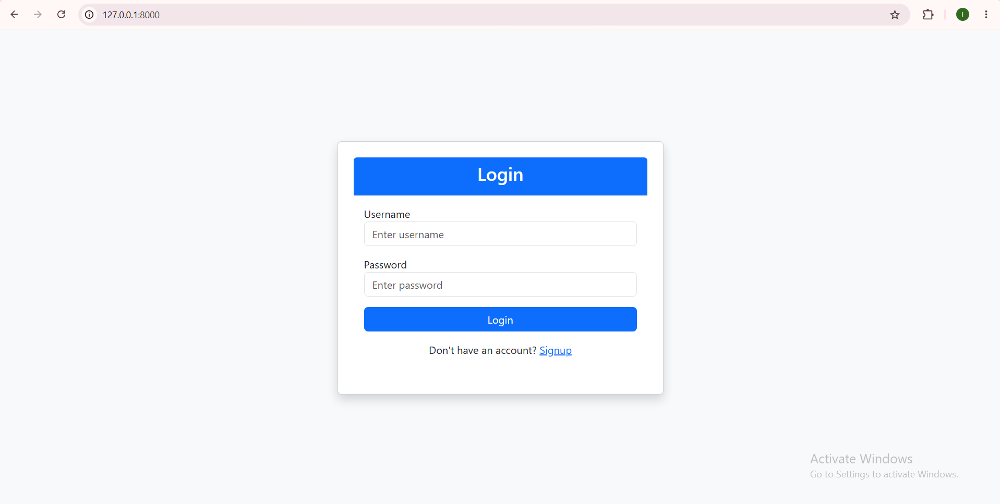
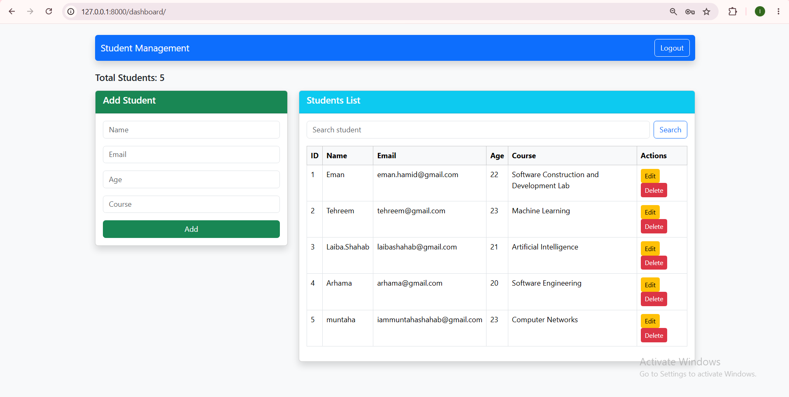

# Django Student Management System

A web-based student management application built with **Python and Django**, featuring user authentication, email-based account activation, and a dashboard for student record management.

The project demonstrates core Django development concepts, including URL routing, views, templates, database models, authentication workflows, email integration, and environment-based configuration.

## Application Preview

The following screenshots showcase the application's user interface and key workflows.

### Signup Page



The signup interface allows new users to register for an account.

### Login Page



The login interface provides access to registered user accounts.

### Student Dashboard



The dashboard provides the main interface for accessing student management functionality.

## Key Features

- **User Registration:** Allows users to create an account.
- **Email Account Activation:** Supports email-based account activation.
- **Authentication:** Provides login and logout functionality.
- **Student Management:** Supports adding student records.
- **Student Search:** Enables users to search student records.
- **Dashboard Interface:** Provides a central interface for application functionality.
- **Environment-Based Configuration:** Uses environment variables for sensitive settings and email credentials.

## Technology Stack

| Technology | Purpose |
|---|---|
| Python | Application programming language |
| Django | Web framework and application logic |
| SQLite | Relational database for local development |
| HTML | Frontend page structure |
| Django Templates | Dynamic server-rendered interfaces |
| python-dotenv | Loading environment variables |
| SMTP | Email delivery configuration |
| Git and GitHub | Version control and source code hosting |

## Project Architecture

The application follows Django's project-and-app structure, separating configuration, application logic, templates, and database migrations.

```text

django-student-management-system/
|-- .gitignore
|-- README.md
|-- requirements.txt
|-- docs/
|   `-- screenshots/
|       |-- signup.png
|       |-- login.png
|       `-- dashboard.png
`-- student_project/
    |-- manage.py
    |-- accounts/
    |   |-- migrations/
    |   |-- templates/
    |   |   |-- dashboard.html
    |   |   |-- login.html
    |   |   `-- signup.html
    |   |-- admin.py
    |   |-- models.py
    |   |-- urls.py
    |   |-- views.py
    |   `-- tests.py
    `-- student_project/
        |-- settings.py
        |-- urls.py
        |-- asgi.py
        `-- wsgi.py

```

### Architectural Components

- **Views:** Handle incoming requests and application workflows.
- **Models:** Define application data structures.
- **URL Configuration:** Maps application URLs to their corresponding views.
- **Templates:** Render the signup, login, and dashboard interfaces.
- **Migrations:** Track database schema changes.
- **Settings:** Configure Django, email services, and environment-based secrets.

## Getting Started

Follow these instructions to run the project locally.

### Prerequisites

- Python 3.12 or a compatible Python version
- Git
- A terminal such as Windows PowerShell
- A Gmail account and an app password if testing Gmail SMTP

### 1. Clone the Repository

```bash
git clone YOUR_GITHUB_REPOSITORY_URL
cd django-student-management-system
```

Replace `YOUR_GITHUB_REPOSITORY_URL` with the repository URL.

### 2. Create a Virtual Environment

On Windows PowerShell:

```powershell
python -m venv .venv
.\.venv\Scripts\Activate.ps1
```

### 3. Install Dependencies

```powershell
python -m pip install -r requirements.txt
```

### 4. Configure Environment Variables

Create a `.env` file in the `student_project/` directory, alongside `manage.py`.

Configure the following variables with your own credentials:

```dotenv
DJANGO_SECRET_KEY=replace-with-a-secret-key
EMAIL_HOST_USER=your-email@example.com
EMAIL_HOST_PASSWORD=your-email-app-password
```

Do not commit `.env` or expose actual credentials in source code, screenshots, or public repositories.

### 5. Apply Database Migrations

```powershell
python student_project\manage.py migrate
```

This creates the database tables required by the application. The local development database is not included in the repository.

### 6. Create an Administrator Account

```powershell
python student_project\manage.py createsuperuser
```

Follow the prompts to configure an administrator account.

### 7. Run the Development Server

```powershell
python student_project\manage.py runserver
```

Open the application at:

http://127.0.0.1:8000/

### 8. Verify the Django Configuration

```powershell
python student_project\manage.py check
```

The project should report no system-check issues when its configuration and dependencies are correct.

## Configuration and Security

The project uses environment variables for sensitive configuration, including the Django secret key and email credentials.

The repository excludes local and machine-specific files such as:

- Environment files containing secrets
- Local SQLite databases
- Python virtual environments
- Python cache files
- IDE configuration directories

**Security considerations before deployment:**

- Use a strong, private Django secret key.
- Configure production settings separately from development settings.
- Replace development-grade account activation URLs with secure, expiring activation tokens.
- Configure appropriate HTTPS, cookie, host, and debug settings.
- Never commit real credentials or private user data.

## Testing and Validation

The Django system check has been executed successfully in the development environment:

```text
System check identified no issues (0 silenced).
```

This confirms that Django's system checks passed at the time of testing. It does not, by itself, establish complete automated test coverage or production readiness.

## Potential Future Enhancements

- Automated tests for authentication and student management workflows
- Role-based access control and permissions
- Improved form validation and user feedback
- Pagination and filtering for student records
- Enhanced responsive UI and accessibility
- Deployment to a production hosting platform
- CI checks for automated quality assurance

These are potential enhancements, not claims about features already implemented.

## License

No license has been selected yet. A license can be added when the project is ready for public distribution.

---

**Developed as a Django web development project.**
